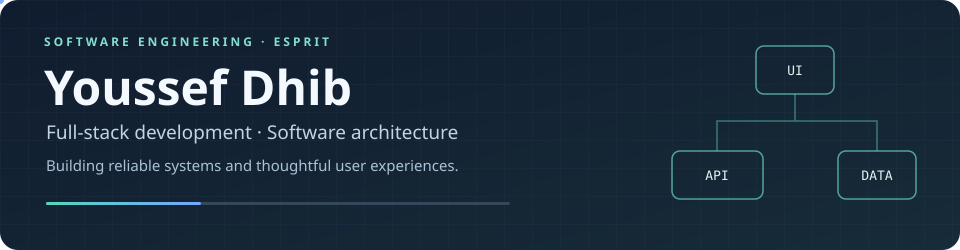
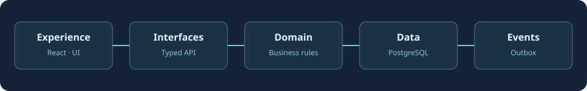

  
  
  

## About me

I'm a Computer Science Engineering student at **ESPRIT** with hands-on experience in full-stack development, software architecture and product engineering. I enjoy translating complex business requirements into reliable, maintainable systems and intuitive user experiences.

My work spans multi-tenant commerce platforms, order management, event-driven workflows, server-rendered storefronts, merchant analytics and logistics dashboard design. I care about correctness as much as usability: clear domain models, typed interfaces, consistent data and reusable UI components.

## Selected experience

### Commerce platform engineering · Lanci internship

- Contributed to monorepo foundations and Docker/PostgreSQL development environments.
- Implemented order management foundations, transactional outbox processing, checkout, pricing and discount workflows.
- Developed merchant analytics, catalog interactions, private receipts and marketing reporting.
- Contributed to a TanStack Start server-side rendering migration, metadata and discoverability improvements.
- Reviewed and improved confirmation, exchange and tenant-isolation behavior in collaboration with the engineering team.

**Technologies:** TypeScript · React · Bun · Express · tRPC · PostgreSQL · Drizzle · Docker · TanStack Start

### Logistics dashboard & driver experience · Design prototype

- Explored a role-specific operational dashboard with Home, My Route and Analytics views.
- Designed map-centric execution previews, contextual stop details, process statistics and responsive mobile drawers.
- Adapted reusable UI patterns to delivery, pickup, transport, return and payment workflows.
- Used fictional data and lightweight simulated interactions to evaluate design alternatives without replacing production business logic.

**Focus:** Product design · Responsive interfaces · Data visualization · Component reuse · Interaction design

## Technology stack

| Area | Technologies |
| --- | --- |
| Languages |     |
| Frontend |      |
| Backend |      |
| Data & tooling |     |

## Engineering interests

- Modular architecture, type-safe APIs and transactional consistency
- Event-driven systems, multi-tenancy and secure application boundaries
- Server-side rendering, performance and maintainable frontend systems
- Operational dashboards, data visualization and accessible responsive UI

## Let's connect

Explore my [public repositories](https://github.com/youfes111?tab=repositories) and follow my work on GitHub. I'm interested in software engineering, full-stack development and product engineering opportunities.
